<div align="center">

# 🏛️ LitHaven

### *A Simple College Book Exchange & Study Notes Sharing Platform*

[](https://www.mongodb.com)
[](https://expressjs.com)
[](https://react.dev)
[](https://nodejs.org)
[](https://jwt.io)
[](https://vitejs.dev)
[](LICENSE)

<br/>

<p align="center">
  
</p>

**LitHaven** is a complete, full-stack **MERN** application built for college students to **buy and sell used books** and **share study notes** (cheat sheets, lecture summaries, and solved question papers) with classmates on campus with zero commission fees.

[📸 Preview](#-application-preview) · [🚀 Quick Start](#-quick-start) · [🏗️ Architecture & Models](#%EF%B8%8F-architecture--data-models) · [🛡️ Verification](#%EF%B8%8F-verification--testing)

---

</div>

## ✨ Key Features

<table>
<tr>
<td width="50%">

### 📖 Find & Sell Books
- **Live Preview**: See your book card update in real-time as you type title, condition, and price.
- **Smart Savings Calculator**: Shows exact discounts compared to original retail prices.
- **Easy Search & Filters**: Search across titles, authors, and subjects. Filter by condition and price in ₹.
- **Campus Meeting Spots**: Pick safe spots to meet on campus (Library, Canteen, Student Center).
- **Popular Textbook Covers**: Instant cover presets for standard books or upload your own photo.

</td>
<td width="50%">

### 📝 Study Notes & Question Papers
- **Helpful Study Materials**: Access formula sheets, class notes, lab manuals, and solved papers.
- **Download Counter**: See how many students have downloaded each resource.
- **Quick Filters**: Filter notes by subject and semester.
- **File Uploads & Links**: Upload PDFs directly or share links.
- **100% Free**: Always free for student collaboration.

</td>
</tr>
<tr>
<td width="50%">

### 💬 Offers & Messages
- **Direct Messaging**: Make offers and chat directly with sellers to arrange a meeting.
- **Easy Offer Controls**: Sellers can Accept, Decline, or mark orders as Done.
- **Safe Campus Chat**: Keeps students connected without having to share personal phone numbers.
- **Automatic Status Updates**: Books update from `available` → `reserved` → `sold`.

</td>
<td width="50%">

### 🔐 Accounts & Profiles
- **Secure Logins**: Fast and safe token-based sign-in.
- **Saved Books**: Bookmark books you like with a single click.
- **Student Profile**: Manage your active listings, saved books, and uploaded notes in one place.

</td>
</tr>
</table>

---

## 📸 Application Preview

<details open>
<summary>🌗 <strong>Dual Theme Experience (Dark & Light Mode)</strong></summary>
<br/>

| Midnight Atelier (Dark Mode) | Travertine Atelier (Light Mode) |
|:---:|:---:|
| 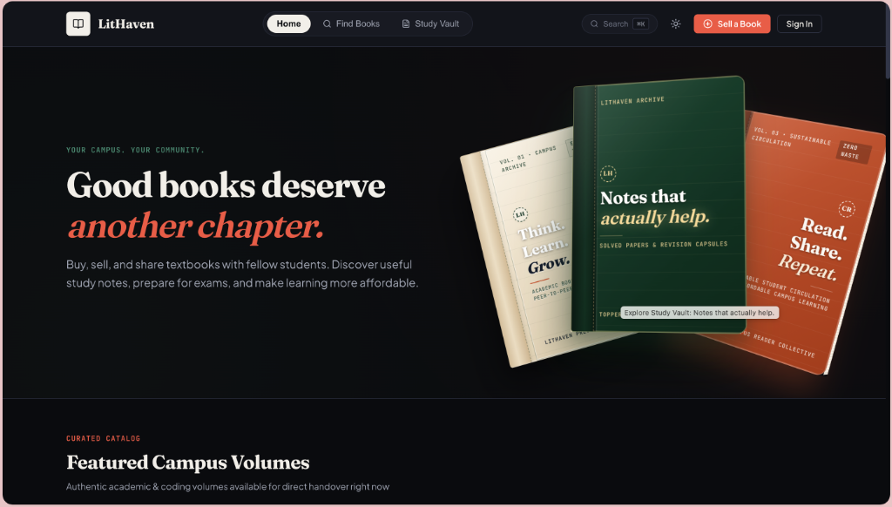 | 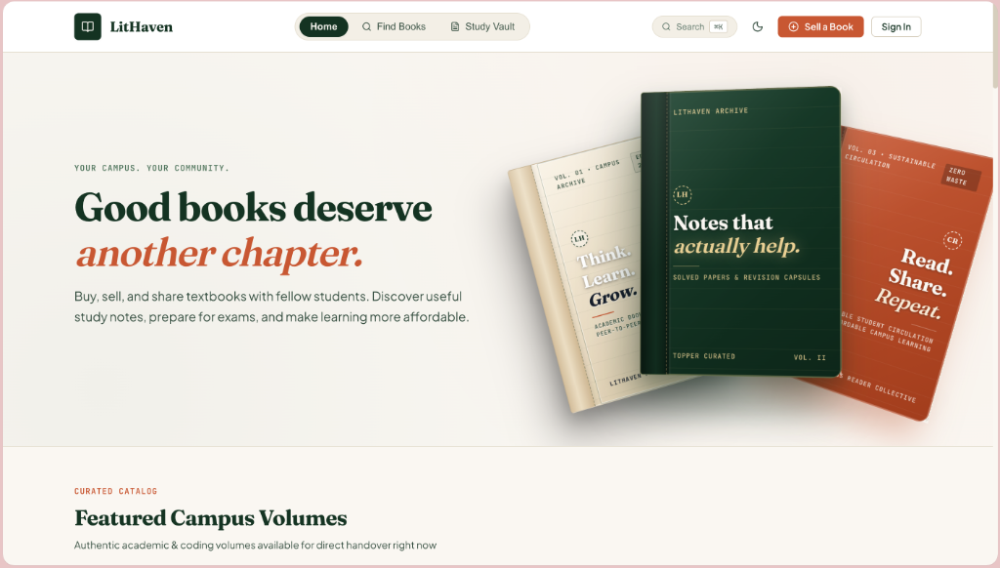 |

</details>

<br/>

<details open>
<summary>📚 <strong>Campus Catalog & Interactive Bookshelf</strong></summary>
<br/>

| Featured Volumes Catalog | Interactive Library Bookshelf Spines |
|:---:|:---:|
| 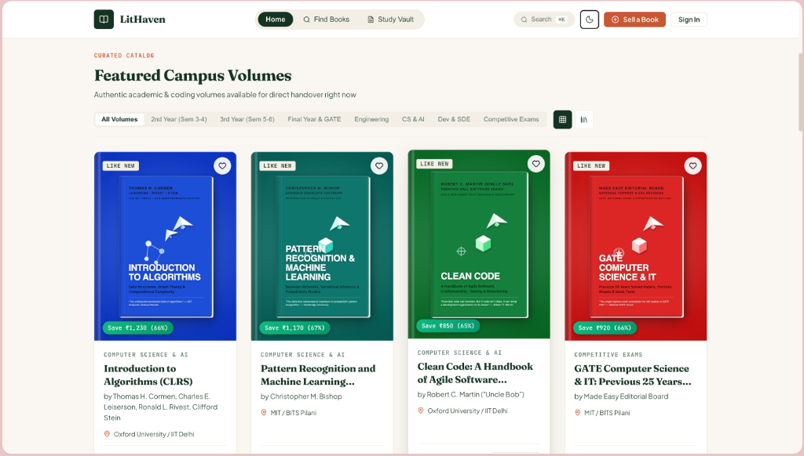 | 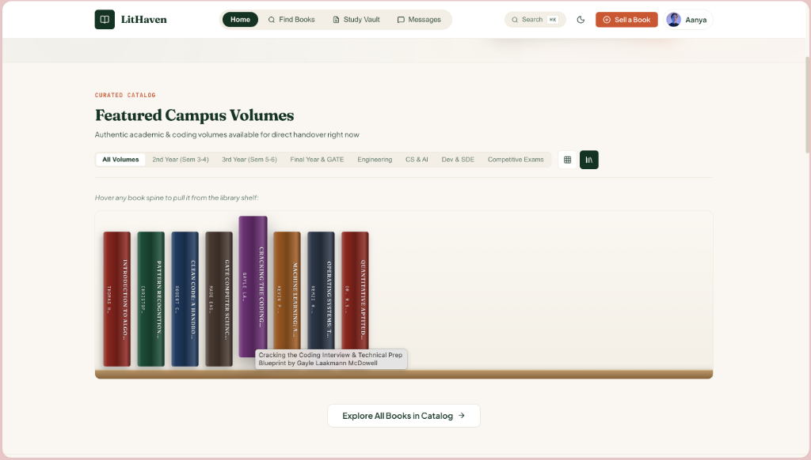 |

</details>

<br/>

<details open>
<summary>🔍 <strong>Search Marketplace & Live Listing Creation</strong></summary>
<br/>

| Filterable Books Marketplace | Live 3D Card Listing Preview |
|:---:|:---:|
| 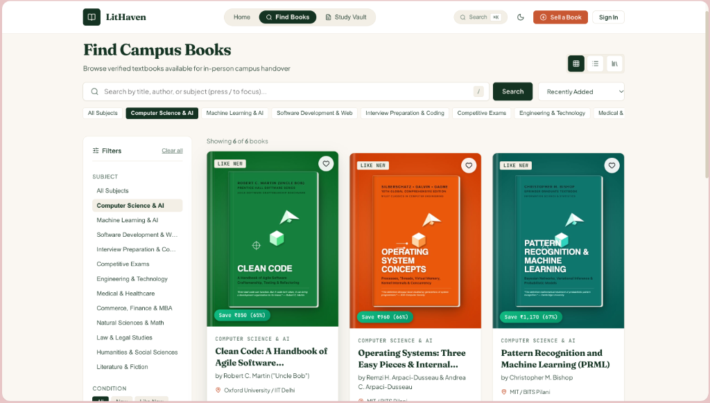 | 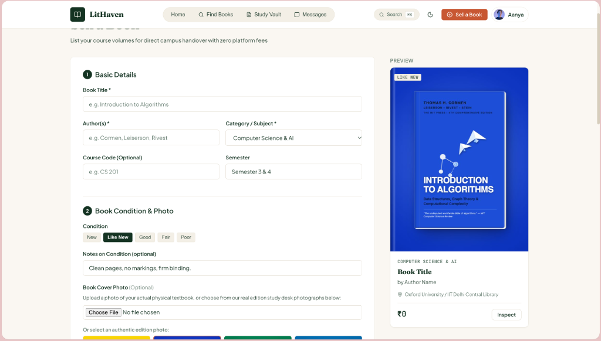 |

</details>

<br/>

<details open>
<summary>📝 <strong>Study Vault & Student Profile Dashboard</strong></summary>
<br/>

| Study Vault & Academic Resources | Student Profile & Active Listings |
|:---:|:---:|
| 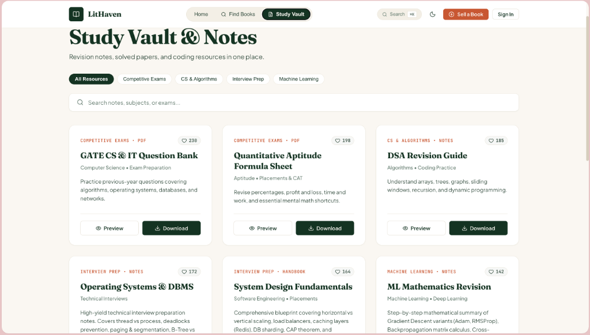 | 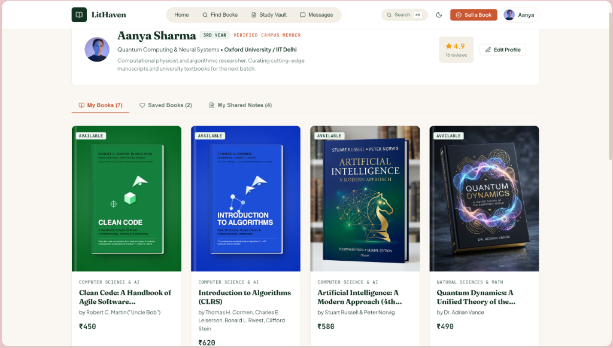 |

</details>

<br/>

<details open>
<summary>💬 <strong>Inquiries, Offers & Direct Campus Chat</strong></summary>
<br/>

<p align="center">
  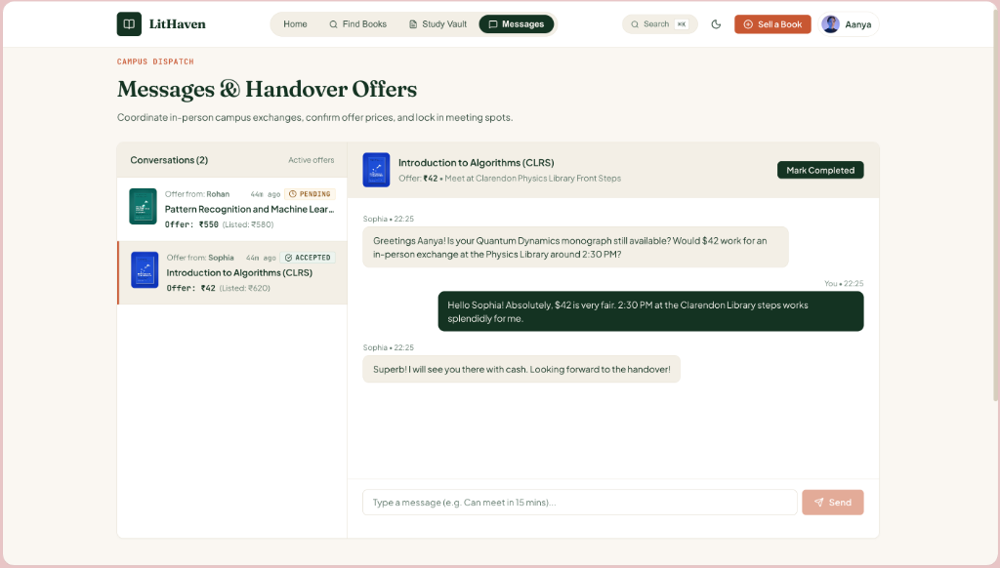
</p>

</details>

---

## 🏗️ Architecture & Data Models

### 📐 System Architecture Diagram

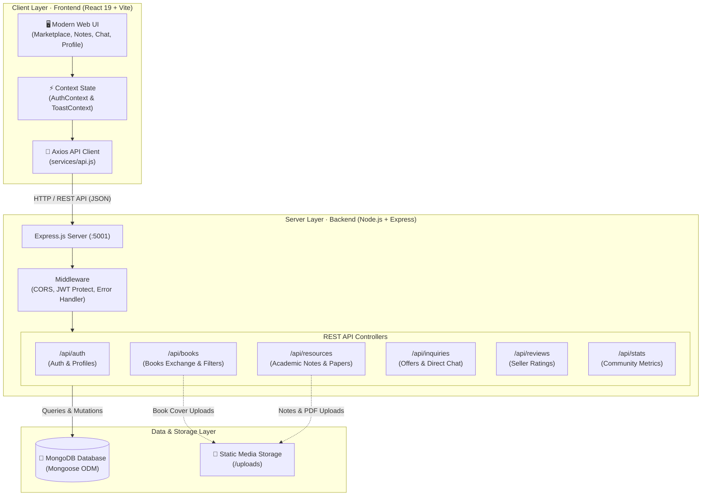

### 🗄️ Database Entity Relationship (ER) Diagram

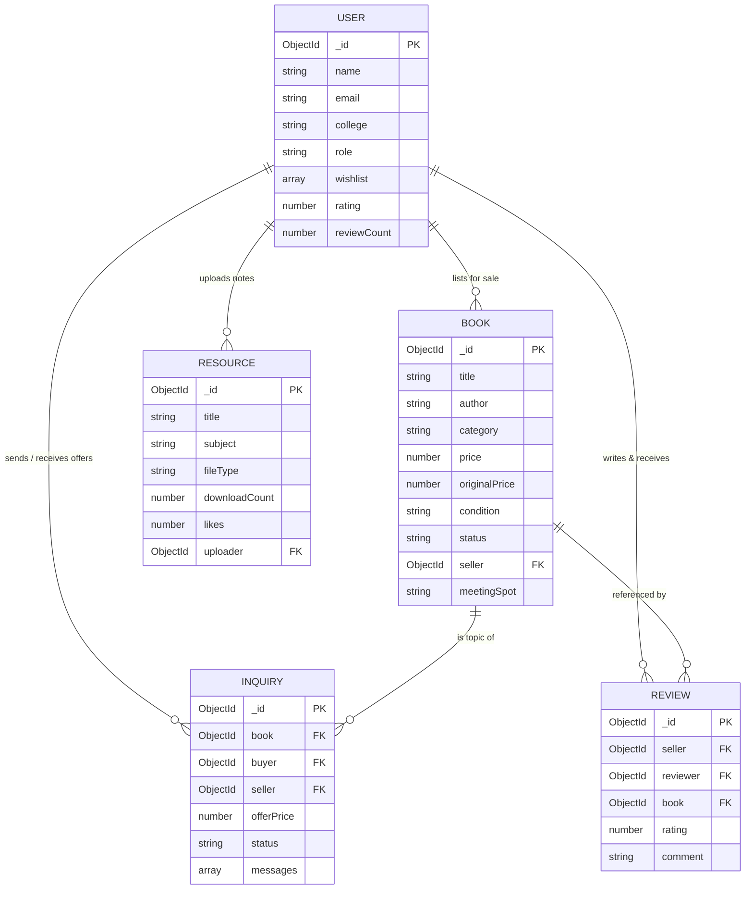

### 📁 Project Directory Structure

```
LitHaven/
├── backend/
│   ├── models/
│   │   ├── User.js             # Student account, college, rating, wishlist
│   │   ├── Book.js             # Textbook listings, condition, price, cover
│   │   ├── Resource.js         # Scriptorium documents, downloads, tags
│   │   ├── Inquiry.js          # Direct buyer-seller offers & chat messages
│   │   └── Review.js           # Seller ratings and feedback
│   ├── routes/
│   │   ├── authRoutes.js       # Register, login, profile, user lookup
│   │   ├── bookRoutes.js       # Codex Exchange CRUD, filters, wishlist toggle
│   │   ├── resourceRoutes.js   # Scriptorium browse, upload, download counter
│   │   ├── inquiryRoutes.js    # Offers, message sending, status updates
│   │   ├── reviewRoutes.js     # Seller reviews
│   │   └── statsRoutes.js      # Platform impact statistics
│   ├── middleware/
│   │   ├── auth.js             # JWT verification middleware
│   │   └── errorHandler.js     # Centralized error handler
│   ├── seed/
│   │   └── seedData.js         # Comprehensive demo data seeder
│   ├── uploads/                # Static asset storage
│   ├── server.js               # Express application entry point
│   └── .env                    # Environment variables
│
├── frontend/
│   ├── src/
│   │   ├── components/         # Navbar, Footer, BookCard, ResourceCard, Modals, Toasts
│   │   ├── context/            # AuthContext, ToastContext
│   │   ├── pages/              # HomePage, Marketplace (Codex Exchange), StudyVault (Scriptorium), CreateBook, Inquiries, Dashboard
│   │   ├── services/api.js     # Centralized backend API client
│   │   ├── index.css           # Complete vanilla CSS design system
│   │   └── App.jsx             # Main routing and modal coordination
│   ├── public/covers/          # High-resolution book cover assets
│   └── vite.config.js          # Vite config with backend proxy on :5001
└── package.json                # Workspace scripts
```

---

## ⚡ Quick Start

### Prerequisites
- **Node.js**: v18+ (tested on Node v24.21)
- **npm**: v9+ (tested on npm 11.19)
- **MongoDB**: v6.0+ (running locally on `mongodb://127.0.0.1:27017` or MongoDB Atlas URI)

---

### 1️⃣ Clone & Install

```bash
cd LitHaven

# Install dependencies for both backend and frontend
npm --prefix backend install
npm --prefix frontend install
```

---

### 2️⃣ Configure Environment

The backend includes a pre-configured `.env` file. You can adjust the port, MongoDB URI, or JWT secret if needed:

```env
PORT=5001
MONGODB_URI=mongodb://127.0.0.1:27017/lithaven
JWT_SECRET=lithaven_super_secret_jwt_key_2026_modern_mern_academic
JWT_EXPIRE=7d
CLIENT_URL=http://localhost:5173
```

---

### 3️⃣ Seed Demo Data *(Recommended)*

Populate your MongoDB database with realistic student accounts, textbooks, notes, and active chat offers:

```bash
cd backend
npm run seed
```


---

### 4️⃣ Run the Application

You can run the backend and frontend in separate terminals:

#### Terminal 1 — Backend API
```bash
cd LitHaven/backend
npm start
# Server will run on http://localhost:5001
```

#### Terminal 2 — Frontend App
```bash
cd LitHaven/frontend
npm run dev
# Frontend will open on http://localhost:5173
```

Now open **[http://localhost:5174](http://localhost:5174)** in your browser!

---

## 🌿 Git Branches

LitHaven maintains synchronized branches for production and features:

```bash
# Main production codebase
git checkout main

# Pro UI/UX feature branch
git checkout redesign/pro-uiux
```

- **`main`**: The primary full-stack production codebase with complete frontend, backend, MongoDB Atlas setup, and seed data.
- **`redesign/pro-uiux`**: Feature and development branch for UI/UX iterations and design refinements.


---

## 🛡️ Verification & Testing

- **Backend Health Check**: Accessible at `http://localhost:5001/health`
- **Frontend Build**: Validated with `vite build` — 0 errors, optimized bundle.
- **Database Seeder**: Verified with Mongoose connection and population tests.

---

<div align="center">

**Built with ❤️ for university students everywhere.**

</div>
